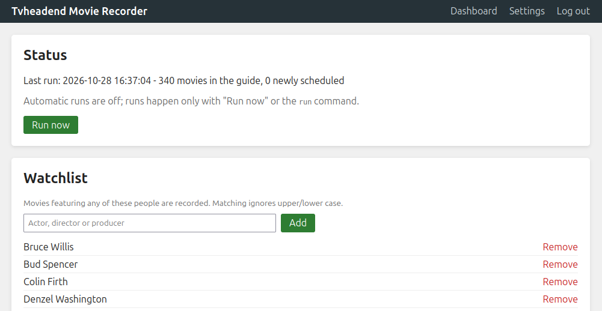
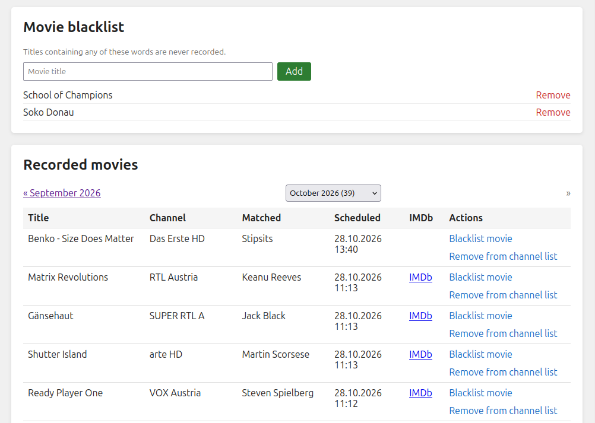
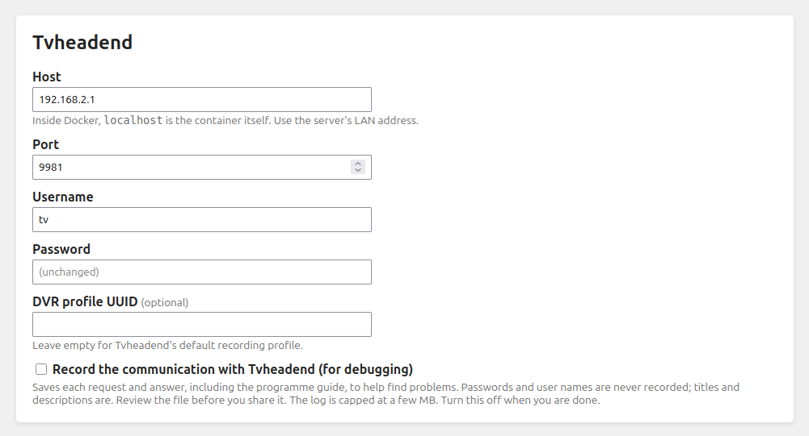
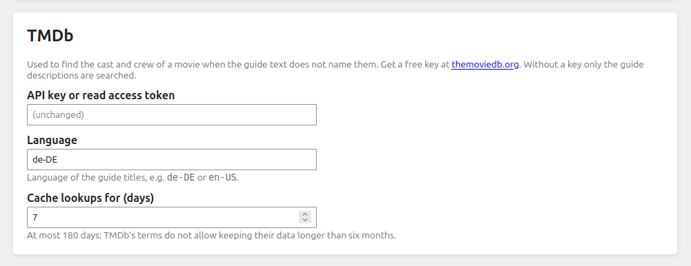
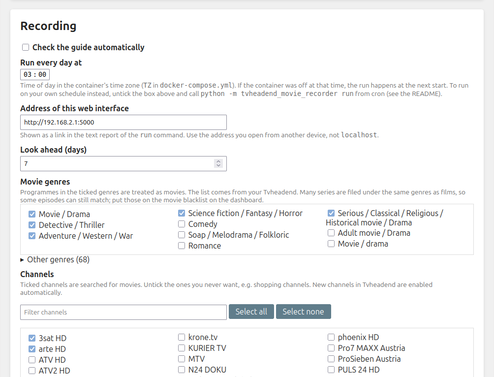
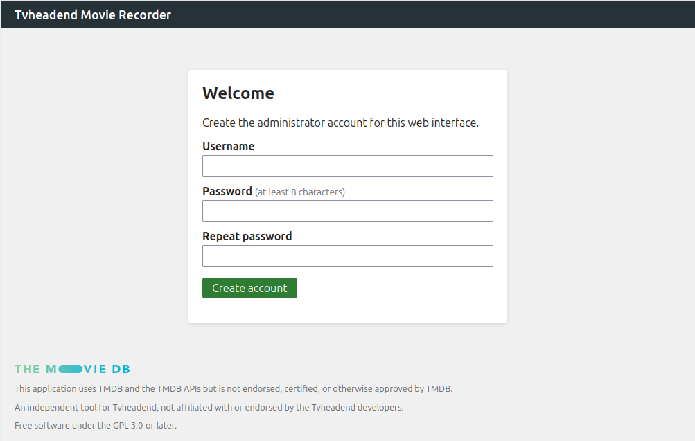

# Tvheadend Movie Recorder

Automatically record TV movies that feature your favourite actors, directors or producers.

It reads the programme guide (EPG) of your [Tvheadend](https://tvheadend.org/) server, picks out the
movies, checks whether anyone on your watchlist is involved, and schedules a recording in Tvheadend.
A web interface lets you manage the watchlist, the movie blacklist, channels and all settings.

> Independent project, not affiliated with or endorsed by the Tvheadend developers. It needs a running
> Tvheadend server to work.

## Screenshots

The dashboard shows the last run, your watchlist and blacklist, and the recorded movies by month:




Everything is configured in the web interface:





## How it works

1. Once a day (03:00 by default, configurable) it fetches the guide events for the next days from Tvheadend.
2. Only events whose genres are all *movie* genres (ticked in Settings), on channels you have not excluded, are considered.
3. A movie is recorded when a watchlist name appears in the guide text (description, summary, subtitle), **or** in
   the movie's cast, directors or producers according to [TMDb](https://www.themoviedb.org/).
   TMDb needs a free API key and is **optional**: without it only the guide text is searched. How much a key
   adds depends on your guide; see *What TMDb adds* below.
4. Blacklisted titles, excluded channels, and titles that already have a recording, are skipped.

## Quick start

Requires Docker with the compose plugin and a reachable Tvheadend server.

```sh
git clone https://github.com/mexx42/tvheadend-movie-recorder.git
cd tvheadend-movie-recorder
mkdir -p data                            # create it yourself, so it belongs to you and not to root
docker compose up -d
```

**Permissions:** the container runs as uid/gid 1000 and needs write access to `./data`. Create the folder
yourself before the first start (as in the commands above); if it does not exist, Docker creates it owned
by root and the app cannot write to it. If your user is not `1000:1000` (check with `id -u` and `id -g`),
uncomment the `user:` line in `docker-compose.yml` and put your ids there. To repair a folder that already
has the wrong owner, run `sudo chown -R <uid>:<gid> data`.

Open `http://<your-server>:5000`:



1. **Create the admin account** (first visit only).
2. **Settings**: enter the Tvheadend host, port, user and password, then press *Test connections*.
   - The Tvheadend user needs permission to view the guide and to manage recordings, and must be allowed
     to connect from the Docker network (see Troubleshooting if you get a 403).
   - If Tvheadend runs on the same machine as Docker, use the machine's LAN IP, or `host.docker.internal`
     (already mapped in `docker-compose.yml`). Inside the container, `localhost` is the container itself.
3. (Optional) Paste a TMDb API key. Create a free account at
   [themoviedb.org](https://www.themoviedb.org/settings/api); both the "API key" and the "read access token" work.
4. Untick **channels** you don't want (e.g. shopping channels) and check the ticked **movie genres**.
5. Add people to the **watchlist** on the dashboard. Press *Run now* to try it. After that it runs by itself every day.

Your data (settings, watchlist, recorded movies, admin account, cache) lives in `./data`. Back up that folder.

## Compatibility

Tested with Tvheadend `4.3_p20240618-r1` on Gentoo. Other 4.x versions use the same HTTP API and are
expected to work, but are untested. If it fails on your version, please open an issue with the
recorded communication (see *Reporting Tvheadend problems*).

## Settings

| Setting | Meaning |
|---|---|
| Movie genres | Programmes in the ticked genres are treated as movies. The list is read from your Tvheadend. Many series are filed under the same genres as films (for example *Detective / Thriller* and *Soap / Melodrama* hold mostly episodes of crime and doctor series), so some episodes will match; put those on the movie blacklist. |
| Channels | Ticked channels are searched, unticked ones are never searched. New channels in Tvheadend are ticked automatically. |
| Look ahead | How many days of the guide to consider. |
| Run every day at | Time of the daily automatic run, in the container's time zone (`TZ`). A missed run happens at the next start. |
| TMDb language | Language of the guide titles, e.g. `de-DE`. Used for the title search. |
| DVR profile UUID | Optional. Empty uses Tvheadend's default recording profile. |
| Record communication | Debugging aid, see *Reporting Tvheadend problems*. Off by default. |
| Cache lookups for | How long TMDb answers are kept, at most 180 days (TMDb's terms do not allow longer). |

The dashboard's *Remove from channel list* link next to a recording unticks that channel in Settings, so it is no longer searched.
Untick or tick channels in Settings at any time.

Matching is case-insensitive. TMDb results use the first search hit for the guide title, so unusual titles
can be matched to the wrong movie. The description match is not affected.

### What TMDb adds

Without a TMDb key the app only looks for your watchlist names in the guide text of each programme (description,
summary, subtitle). With a key it also checks each movie's cast, directors and producers on TMDb.

How much that adds depends on your guide and your watchlist. In one test on a real week of a German-language
guide (341 programmes in the ticked genres, 142 distinct titles), the guide text named a watchlist person for 6
titles and TMDb for 5. Only one of the TMDb matches was not already found from the text (*Shutter Island*, via its
director). That is a single week and one watchlist, so treat it as a rough idea, not a promise. If you do not want
a TMDb account, the app works without one; it also stores an IMDb link for each recording only when TMDb was used.

## Running from cron (and getting mail)

The container runs the check once a day by itself (*Settings > Recording > Run every day at*). If you prefer
your own schedule, or want an email when something was recorded or something broke, untick *Check the guide
automatically* and let cron call the app. Cron mails whatever a job prints, so no mail server is built in.

```sh
MAILTO=you@example.org
0 20 * * * cd /path/to/tvheadend-movie-recorder && docker compose exec -T tvheadend-movie-recorder python -m tvheadend_movie_recorder run --quiet
```

- `run` does one pass and prints a plain-text report:

  ```
  Tvheadend Movie Recorder - 2026-10-28 20:00
  Status: OK - 112 movies in the guide

  New recordings (2):
    Fri 30.10. 20:15  ORF1     Die Hard (Bruce Willis)
    Sat 31.10. 22:05  ZDF neo  Heat (Al Pacino)

  Manage: http://192.168.1.10:5000/
  ```
- `--quiet` prints only when something was scheduled or something went wrong, so you are not mailed on quiet days.
  Errors go to stderr with exit code 1.
- The "Manage" link comes from *Settings > Address of this web interface* (or the `PUBLIC_URL` environment
  variable). The settings page suggests the address your browser used; check it is reachable from other devices.
- A run never overlaps another: if the built-in scheduler or "Run now" is busy, `run` waits (`--wait SECONDS`,
  default 300) and then reports it.
- Runs started this way show up on the dashboard like any other.

## Troubleshooting

- **`pip install` fails with "Temporary failure in name resolution" during `docker compose build`:**
  containers cannot use your router's DNS server. Either set a resolver for Docker globally
  (`{"dns": ["1.1.1.1"]}` in `/etc/docker/daemon.json`, then restart Docker), or build with
  `docker compose build --network host` and add `dns: [1.1.1.1]` to the service in `docker-compose.yml`.
  The same applies at runtime, otherwise the TMDb lookup cannot resolve `api.themoviedb.org`.
- **"Permission denied" writing to `/data`, or the container exits right after start:** the container user
  cannot write to the `./data` folder. This happens when Docker created the folder itself (owned by root)
  or when your user is not uid 1000. See *Permissions* under Quick start.
- **Tvheadend answers 403 although the login is right:** Tvheadend limits each user to certain networks.
  The container does not appear as your LAN address, but as a Docker address (usually `172.16.0.0/12`).
  In Tvheadend open *Configuration > Users > Access Entries*, and add that network to *Allowed networks*
  of the entry your user belongs to. The app shows the same hint when it gets a 403.
- **No movies found:** open *Settings > Recording* and check the ticked *Movie genres* (the list is read from your
  Tvheadend) and the ticked channels, then run with `LOG_LEVEL=DEBUG`.

## Reporting Tvheadend problems

If the app misbehaves with your Tvheadend (no movies found, odd errors), you can record what it exchanges
with the server: in *Settings > Tvheadend* tick *Record the communication with Tvheadend*, save, press
*Run now* on the dashboard, then download the file from *Settings* and attach it to an issue.

- Each line is one request with its answer (JSON lines). Host name, password and user name are never recorded;
  user and file fields in the answers are blanked, long lists are cut. **Titles and descriptions from your
  programme guide are recorded, so skim the file before you share it.**
- The log is rotated at about 2 MB (one older copy is kept), and can be deleted in *Settings*.
  Turn the option off again afterwards.

## Security notes

- Designed for a trusted home network over plain http. **Do not expose it directly to the internet.**
- The web interface needs a login. Passwords are stored as hashes, but the Tvheadend password and the TMDb key
  must be stored in plain text in `data/config.yaml` (file mode 600) because the app needs them.
- For https, put a reverse proxy in front and set `SESSION_COOKIE_SECURE=true`.
  [`docs/docker-compose.traefik.yml`](docs/docker-compose.traefik.yml) shows a Traefik setup.
- If you lose the admin password, stop the container, delete `data/auth.json` and open the page again to create a new account.

## Configuration via environment

| Variable | Default | Meaning |
|---|---|---|
| `PUBLIC_URL` | from Settings | Address shown in the `run` report, overrides the setting |
| `DATA_DIR` | `/data` in the container | Where all data is stored |
| `PORT` | `5000` | Web interface port |
| `LOG_LEVEL` | `INFO` | `DEBUG`, `INFO`, `WARNING`, ... |
| `SESSION_COOKIE_SECURE` | off | Set to `true` when served over https |
| `TZ` | UTC | Timezone for log and displayed times |

## Run without Docker

```sh
python -m venv ve && ve/bin/pip install -r requirements.txt
DATA_DIR=./data ve/bin/python -m tvheadend_movie_recorder
```

or `pip install .` and run `tvheadend-movie-recorder`.

## Development

```sh
ve/bin/pip install -r requirements.txt pytest
ve/bin/python -m pytest
```

See [CONTRIBUTING.md](CONTRIBUTING.md).

## Credits and licence

<a href="https://www.themoviedb.org/"></a>

This application uses TMDB and the TMDB APIs but is not endorsed, certified, or otherwise approved by TMDB.

Movie data comes from [TMDB](https://www.themoviedb.org/), used under its
[API terms](https://www.themoviedb.org/api-terms-of-use). They allow non-commercial use only, so this
project is free of charge and takes no payments or donations tied to the TMDB data. Every user needs their
own TMDB API key. Cached TMDB data is deleted after at most 180 days.

Tvheadend is a trademark or project of its respective owners. This project is an independent tool for
Tvheadend and is not affiliated with, endorsed by or supported by the Tvheadend developers.

Free software under the [GPL-3.0-or-later](LICENSE). Copyright (C) 2026 Marcus Priesch.
